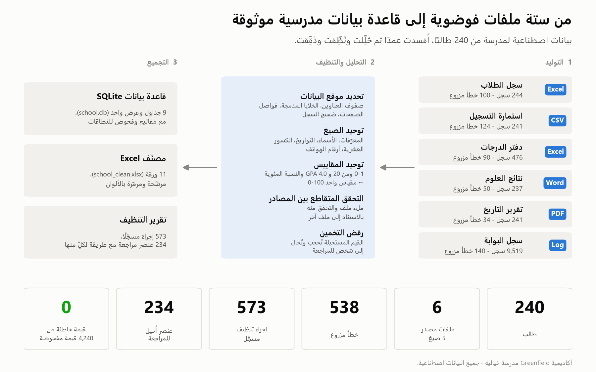
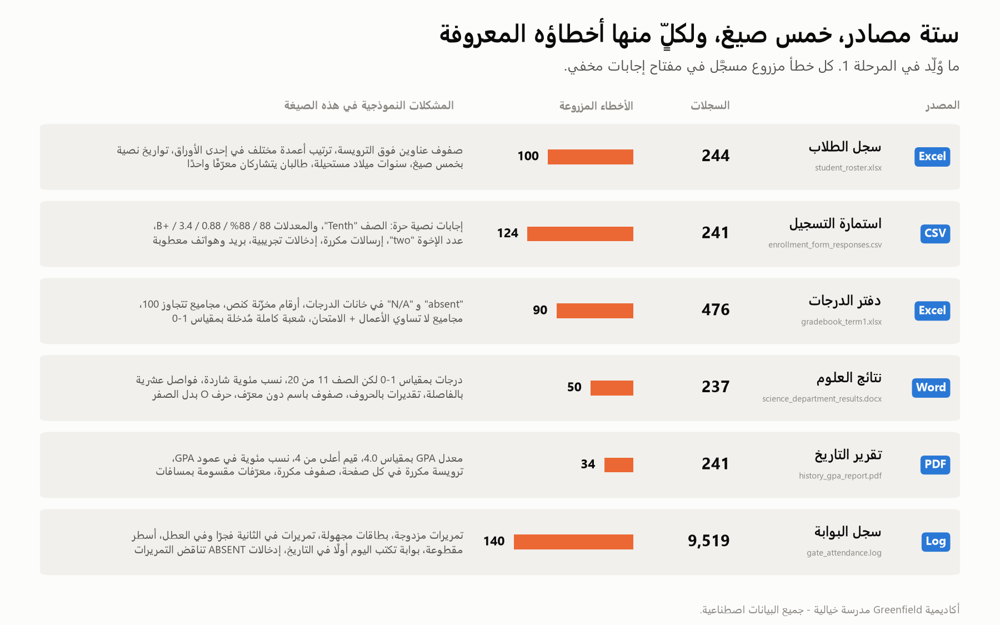
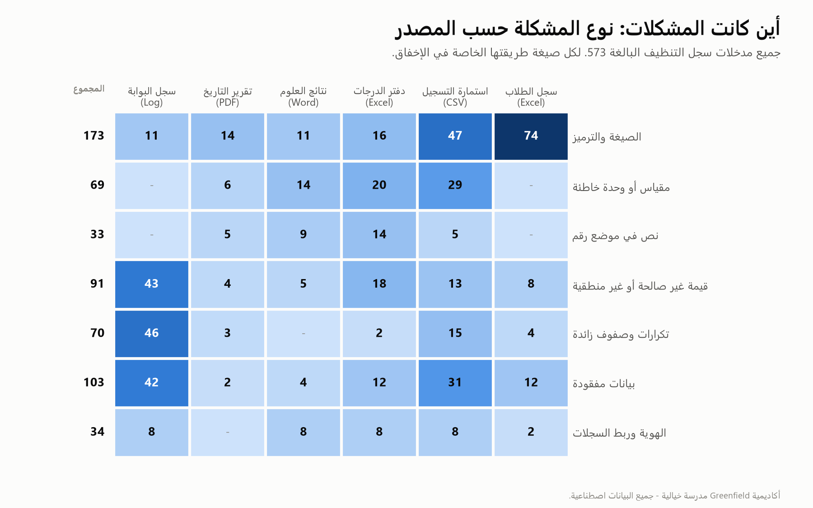
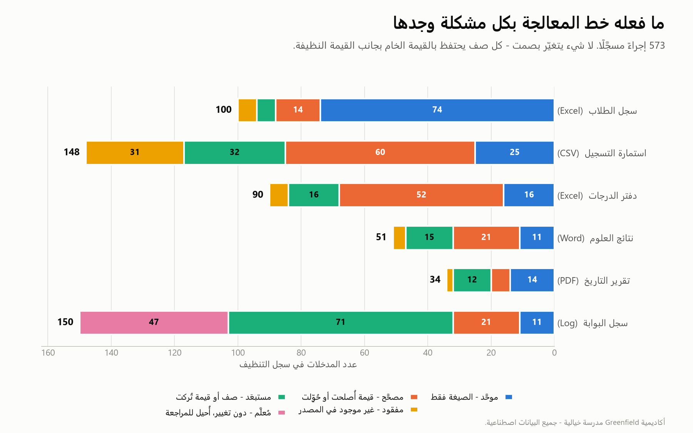
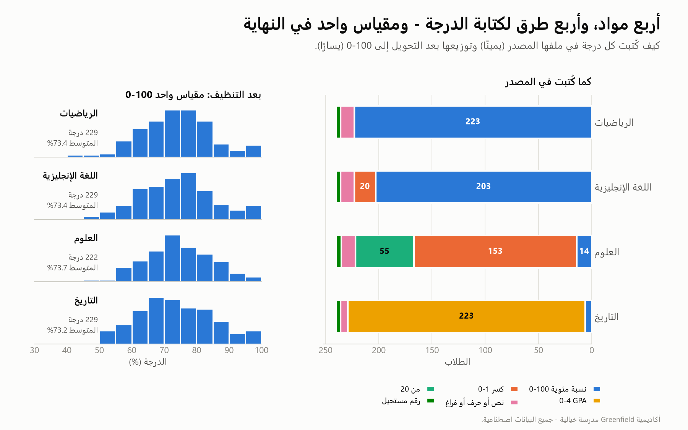
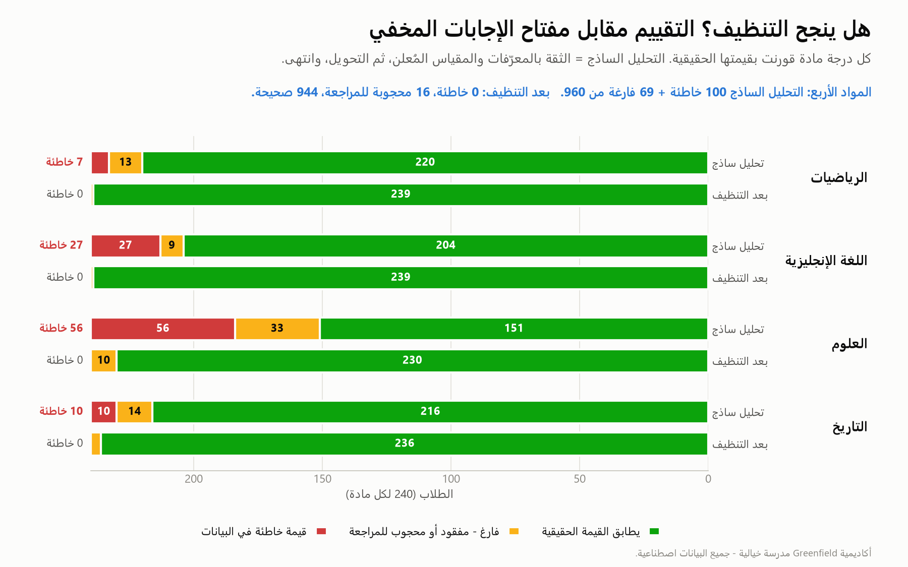
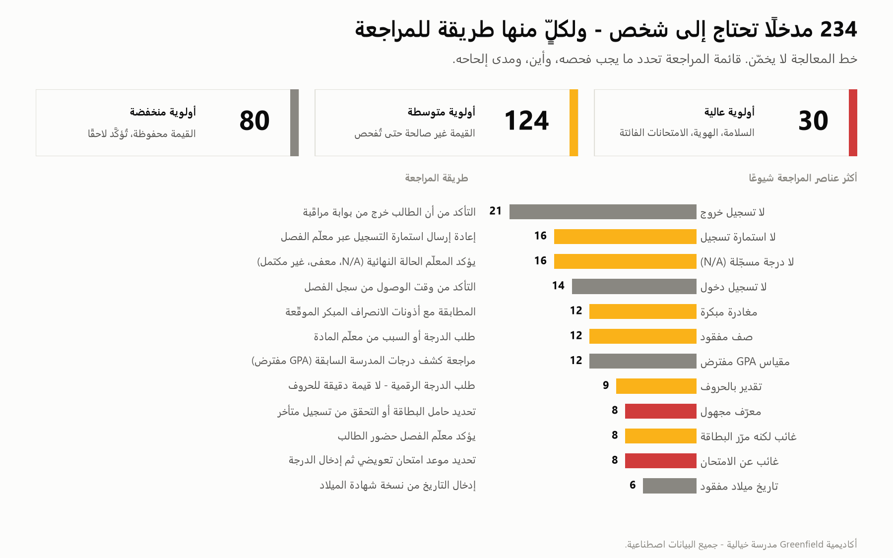
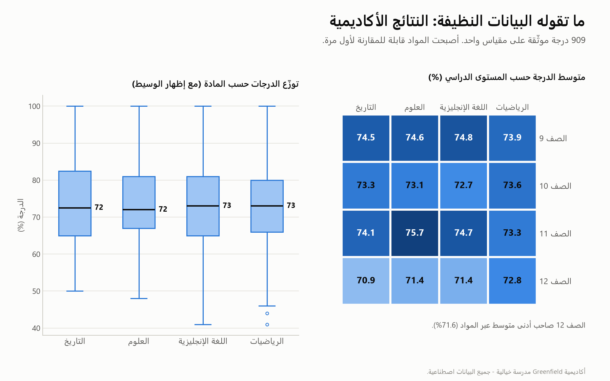
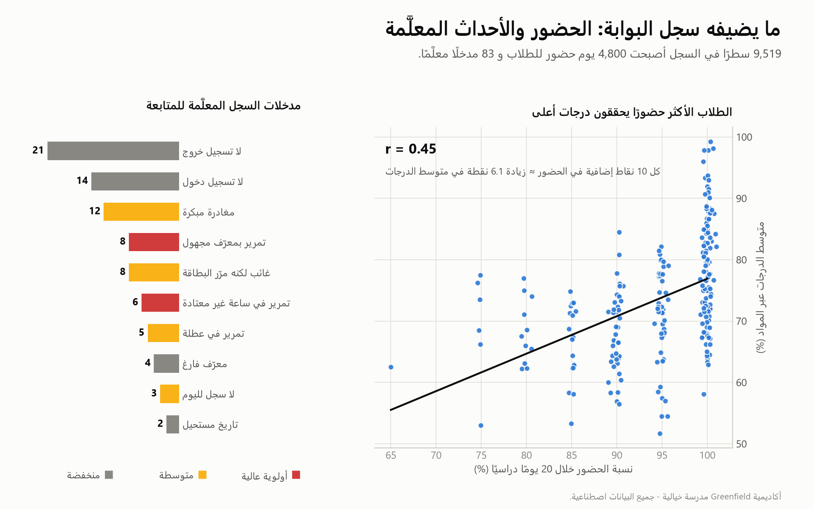
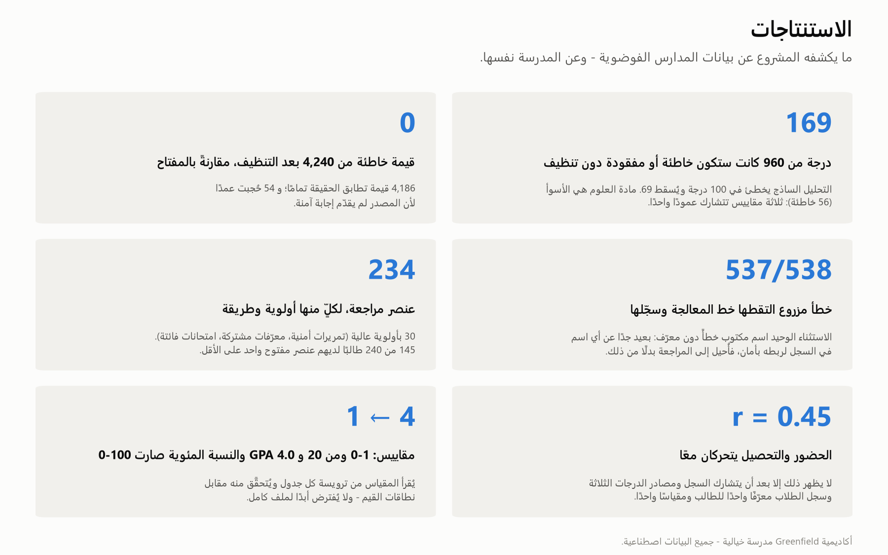

[English](README.md)

<div dir="rtl">

# بيانات المدرسة: من ستة ملفات فوضوية إلى قاعدة بيانات واحدة موثوقة

## مقدمة

نادرًا ما تحتفظ المدارس ببياناتها في مكان واحد. فلدى المسجّل سجلّ في Excel، ويملأ أولياء الأمور
استمارة عبر الإنترنت، ويرفع كل قسم درجاته بطريقته الخاصة (جدول بيانات، أو مستند Word، أو ملف PDF)،
ويكتب جهاز التحكم في البوابة سجلًّا لا يقرؤه أحد. وكل صيغة من هذه الصيغ تتعطل بطريقتها المميزة،
وتستخدم كل منها مقياسها الخاص، فلا يمكن ببساطة تكديس الملفات بعضها فوق بعض.

يعيد هذا المشروع إنتاج هذا الوضع من البداية إلى النهاية لمدرسة خيالية هي **Greenfield Academy**
(240 طالبًا، الصفوف 9-12، الفصل الأول من العام الدراسي 2026/27)، ثم يحلّه:

1. **التوليد** - تُولَّد مدرسة "حقيقية" واحدة، ثم تُكتب في ستة ملفات مصدر بخمس صيغ، مع 538 خطأً
   مزروعًا عمدًا من الأخطاء النموذجية لكل صيغة. وتُسجَّل الأخطاء المزروعة في مفتاح إجابات مخفي.
2. **التحليل والتنظيف** - يقرأ خط معالجة الملفات الستة كلها، ويوحّد الصيغ والترميز، ويحوّل أربعة
   مقاييس درجات مختلفة إلى مقياس واحد، ويتحقق من المصادر بمقارنة بعضها ببعض، ثم يجمّع قاعدة بيانات
   SQLite ومصنّف Excel. ويُسجَّل كل تغيير مع القيمة الخام بجانب القيمة النظيفة. وأي شيء لا يمكن حلّه
   بأمان لا يُخمَّن: بل يُحجب ويوضع في قائمة مراجعة مع أولوية وطريقة لإجراء المراجعة.
3. **العرض** - عشر صور تشرح ما أُنجز وما اكتُشف، بما في ذلك تقييم التنظيف مقابل مفتاح الإجابات.

جميع البيانات اصطناعية. لا تمثّل أي مدرسة أو طالب أو أسرة حقيقية.

## أبرز النتائج

| | |
|---|---|
| السجلات المقروءة من المصادر | 10,958 عبر 6 ملفات (Excel x2، CSV، Word، PDF، log) |
| إجراءات التنظيف المسجّلة | 573 (151 موحَّدًا، 174 مصحَّحًا، 152 مستبعَدًا، 49 مفقودًا، 47 مُعلَّمًا) |
| المدخلات المُحالة إلى مراجعة بشرية | 234 (30 عالية الأولوية، 124 متوسطة، 80 منخفضة) |
| درجات المواد على مقياس واحد 0-100 | 909 من 960 (الـ 51 الباقية غائبة أو محجوبة أو لم تُسجَّل قط) |
| القيم المفحوصة مقابل مفتاح الإجابات | 4,240 - **4,186 صحيحة، 54 محجوبة، 0 خاطئة** |
| الدرجات نفسها بتحليل ساذج | 100 خاطئة و 69 مفقودة من أصل 960 |
| الأخطاء المزروعة التي التُقطت | 537 من 538 (الأخير أُحيل إلى المراجعة بدلًا من تخمينه) |

## العرض المرئي

| | |
|---|---|
|  **1. نظرة عامة على المشروع** - المراحل الثلاث والأرقام الرئيسية. |  **2. المصادر الستة** - ما هو كل ملف وكيف أُفسد. |
|  **3. خريطة الشذوذ** - أي نوع من المشكلات ظهر في أي صيغة. |  **4. الإجراءات المتخذة** - موحَّد، مصحَّح، مستبعَد، مفقود، مُعلَّم. |
|  **5. توحيد المقاييس** - 0-1 ومن 20 و GPA والنسبة المئوية تصبح مقياسًا واحدًا. |  **6. الساذج مقابل المنظَّف** - كلاهما مُقيَّم مقابل مفتاح الإجابات. |
|  **7. قائمة المراجعة** - ما يحتاج إلى شخص، ومدى إلحاحه، وكيف يُفحص. |  **8. النتائج الأكاديمية** - ما تقوله البيانات النظيفة عن المواد والصفوف. |
|  **9. الحضور وإشارات السجل** - ما يضيفه سجل البوابة. |  **10. الاستنتاجات** |

النسخة الإنجليزية من الصور موجودة في `showcase/`.

## محتويات هذا المجلد

</div>

```
raw_data/        Phase 1 output - the six messy source files
  01_student_roster.xlsx              one sheet per grade; title rows, mixed date notations, shared IDs
  02_enrollment_form_responses.csv    online-form export; free-text answers on several scales
  03_gradebook_term1.xlsx             Math and English; coursework/40 + exam/60 = total/100
  04_science_department_results.docx  Word tables; 0-1 scale, Grade 11 out of 20
  05_history_gpa_report.pdf           7-page PDF table; GPA on a 4.0 scale
  06_gate_attendance.log              9,519 gate-controller lines over 20 school days
ground_truth/    the true values and the list of planted errors (never read by the cleaning step)
clean_data/      Phase 2 output
  school.db                 SQLite: students, guardians, grades, attendance_daily, attendance_summary,
                            log_flags, cleaning_log, review_queue, format_harmonisation, v_student_overview
  school_clean.xlsx         the same data in 11 filtered sheets, incl. Corrections / Omissions / Needs Review
  staging_grades.csv        raw value beside clean value for every score
reports/
  cleaning_report.md        corrections, omissions and review items, with the review method for each kind
  cleaning_report.ar.md     Arabic translation of the cleaning report
  evaluation.json           the score against the answer key
showcase/        Phase 3 output - the ten images
showcase_ar/     Arabic versions of the ten images
scripts/         01_generate_sources.py -> 02_clean_and_compile.py -> 03_evaluate.py -> 04_showcase.py
                 04_showcase_ar.py (Arabic images)
```

<div dir="rtl">

شرح موجز للمحتويات أعلاه:

- `raw_data/` - مُخرجات المرحلة 1: ملفات المصدر الستة الفوضوية.
  - `01_student_roster.xlsx` - ورقة لكل صف؛ صفوف عناوين، وصيغ تواريخ مختلطة، ومعرّفات مشتركة.
  - `02_enrollment_form_responses.csv` - تصدير استمارة عبر الإنترنت؛ إجابات نصية حرة بعدة مقاييس.
  - `03_gradebook_term1.xlsx` - الرياضيات واللغة الإنجليزية؛ الأعمال من 40 + الامتحان من 60 = المجموع من 100.
  - `04_science_department_results.docx` - جداول Word؛ مقياس 0-1، والصف 11 من 20.
  - `05_history_gpa_report.pdf` - جدول PDF من 7 صفحات؛ معدل GPA على مقياس 4.0.
  - `06_gate_attendance.log` - 9,519 سطرًا من جهاز التحكم في البوابة على مدى 20 يومًا دراسيًا.
- `ground_truth/` - القيم الحقيقية وقائمة الأخطاء المزروعة (لا تقرؤها خطوة التنظيف أبدًا).
- `clean_data/` - مُخرجات المرحلة 2.
  - `school.db` - قاعدة SQLite تضم الجداول: students و guardians و grades و attendance_daily و attendance_summary و log_flags و cleaning_log و review_queue و format_harmonisation، والعرض v_student_overview.
  - `school_clean.xlsx` - البيانات نفسها في 11 ورقة مرشّحة، منها Corrections و Omissions و Needs Review.
  - `staging_grades.csv` - القيمة الخام بجانب القيمة النظيفة لكل درجة.
- `reports/` - `cleaning_report.md` (التصحيحات والاستبعادات وعناصر المراجعة، مع طريقة المراجعة لكل نوع)، وترجمته العربية `cleaning_report.ar.md`، و`evaluation.json` (التقييم مقابل مفتاح الإجابات).
- `showcase/` - مُخرجات المرحلة 3: الصور العشر؛ و`showcase_ar/` نسخها العربية.
- `scripts/` - تُشغَّل بالترتيب: `01_generate_sources.py` ثم `02_clean_and_compile.py` ثم `03_evaluate.py` ثم `04_showcase.py`؛ ويولّد `04_showcase_ar.py` الصور العربية.

## كيف يتخذ التنظيف قراراته

- **التوحيد** عندما تختلف الصيغة فقط: `stu_0042` و `STU-O042` و `42` كلها تصبح `STU-0042`؛
  و `0,85` تصبح `0.85`؛ و `" SMITH "` تصبح `Smith`.
- **التحويل** عندما يكون المقياس معروفًا. يُقرأ المقياس من ترويسة الجدول نفسه (ملف Word يعلّم الصف 11
  بـ "/20") ويُتحقق منه مقابل نطاق القيم، ولا يُفترض أبدًا لملف كامل. ويُحوَّل GPA وفق السياسة المطبوعة
  في تقرير التاريخ: *Percent = 50 + 12.5 x GPA*.
- **التحقق المتقاطع** بين مصدر وآخر: يُملأ تاريخ الميلاد المفقود من استمارة التسجيل؛ ويُستبدل المجموع
  الذي لا يتفق مع الأعمال + الامتحان بحاصل جمعهما؛ ويُفصل بين طالبين يتشاركان معرّفًا واحدًا باستخدام
  زوج الاسم والمعرّف في الاستمارة. وكل هذه الحالات تُرسل أيضًا للتأكيد.
- **الحجب** عندما لا تعطي أي قاعدة إجابة آمنة: `8.5` في عمود 0-1، أو GPA بقيمة `4.8`، أو `B+` في خانة
  رقمية، أو درجتان مختلفتان لطالب واحد. تُترك الخانة فارغة ويذهب المُدخل إلى قائمة المراجعة مع قيمة
  مقترحة إن وُجدت.

## إعادة الإنتاج

Python 3 مع pandas و numpy و openpyxl و matplotlib و python-docx و reportlab و pdfplumber.
وتحتاج الصور العربية أيضًا إلى arabic-reshaper و python-bidi (يستخدمهما `scripts/04_showcase_ar.py`
فقط مع إصدارات matplotlib الأقدم من 3.11؛ أما الإصدارات الأحدث فتشكّل النص العربي بنفسها).

</div>

```
python scripts/01_generate_sources.py
python scripts/02_clean_and_compile.py
python scripts/03_evaluate.py
python scripts/04_showcase.py
python scripts/04_showcase_ar.py
```

<div dir="rtl">

يولّد الأمر الأخير النسخ العربية من الصور العشر في `showcase_ar/`.

يستخدم المولّد بذرة عشوائية ثابتة (seed)، لذا ينتج كل تشغيل الملفات نفسها والأرقام نفسها.

## حدود تجدر معرفتها

- الأخطاء زرعها المؤلف نفسه الذي كتب أداة التنظيف، لذا فإن "0 خاطئة" هي أفضل حالة ممكنة. ستحتوي
  الملفات الحقيقية على أنواع أخطاء لم يتوقعها أحد؛ وقائمة المراجعة هي شبكة الأمان لتلك الحالات.
- العلاقة بين الحضور والتحصيل (r = 0.45) مبنية داخل المولّد. والغرض من الصورة 9 هو أن العلاقة
  لا تصبح قابلة للقياس إلا بعد ربط المصادر، لا أنها اكتُشفت.
- ملف PDF نصي. أما ملف PDF الممسوح ضوئيًا فسيحتاج أولًا إلى التعرف الضوئي على الحروف (OCR)، وسيضيف
  فئة جديدة من الأخطاء.

</div>
