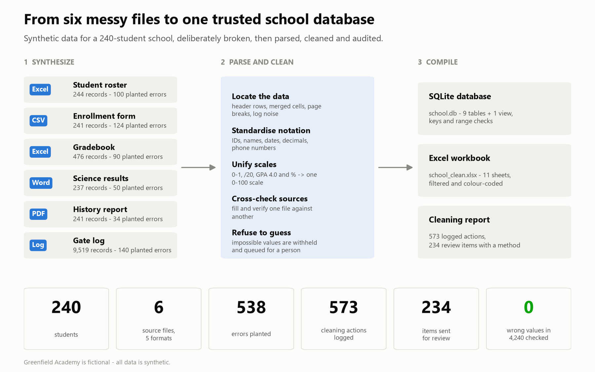
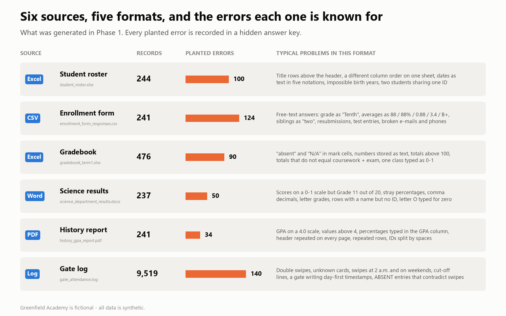
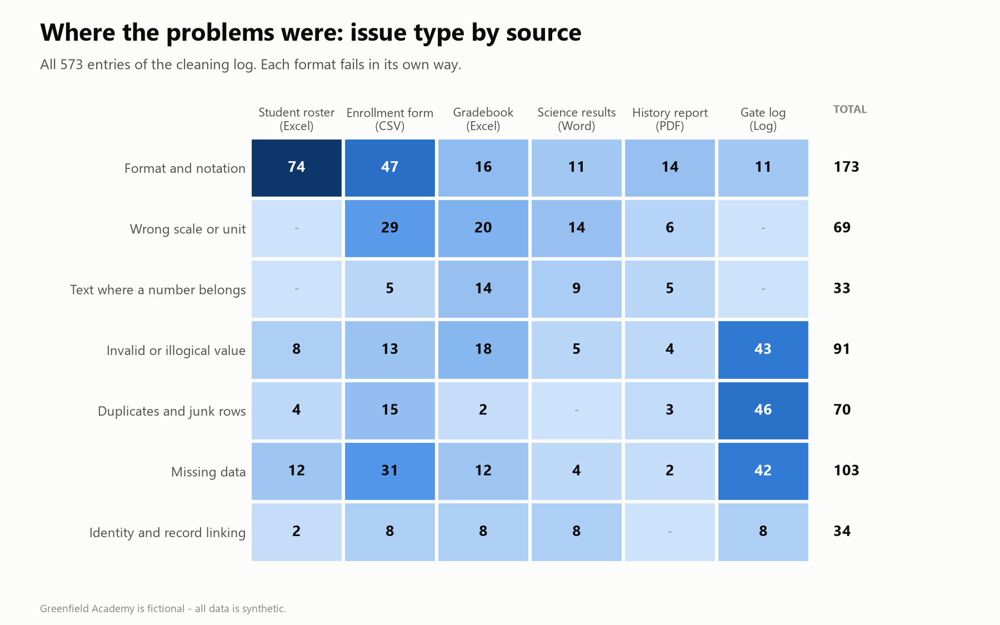
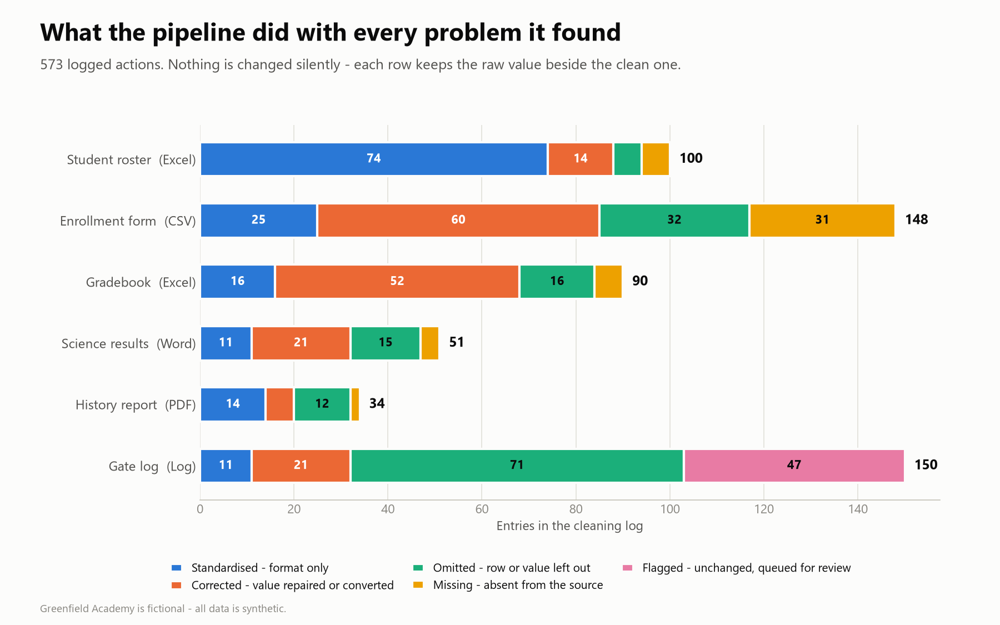
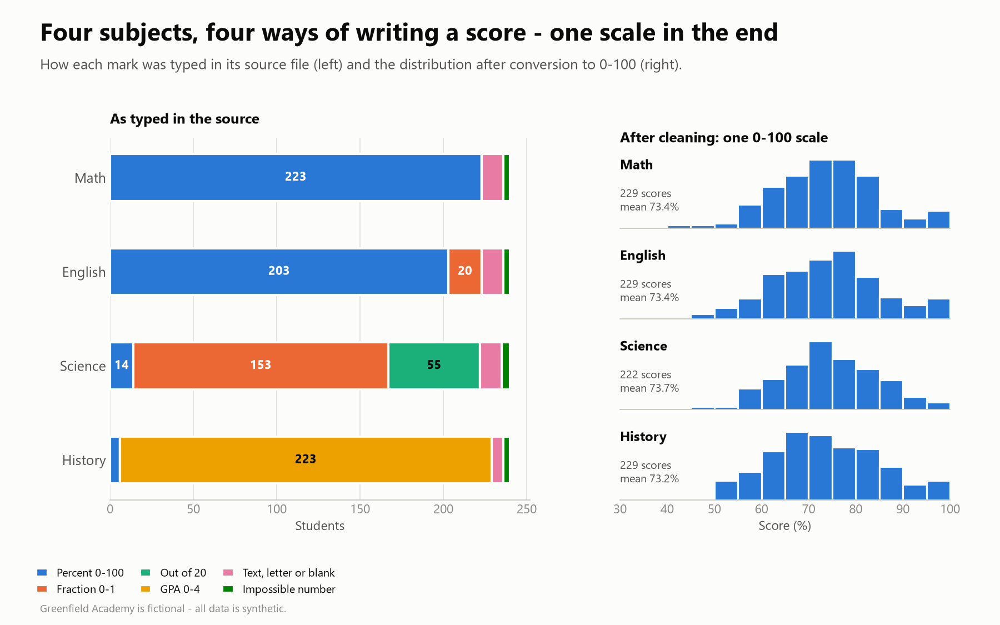
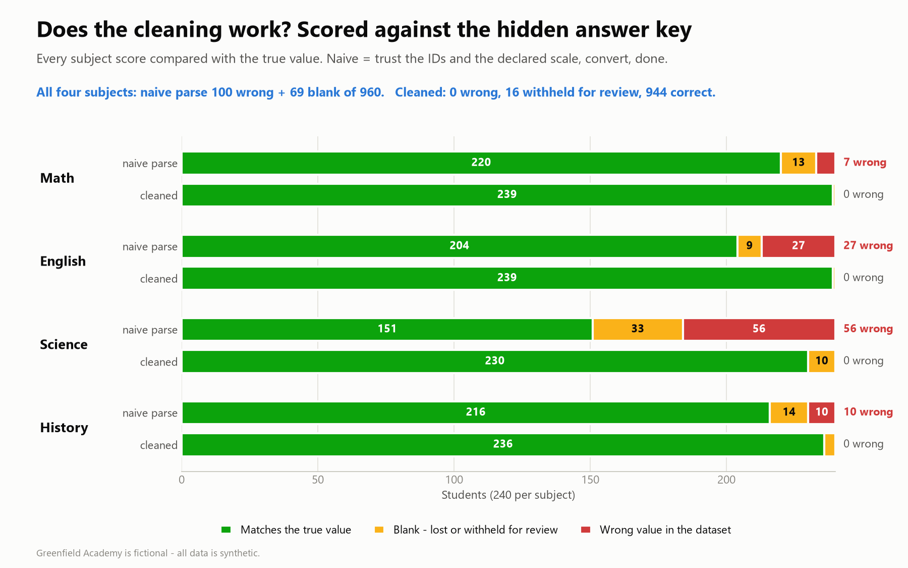
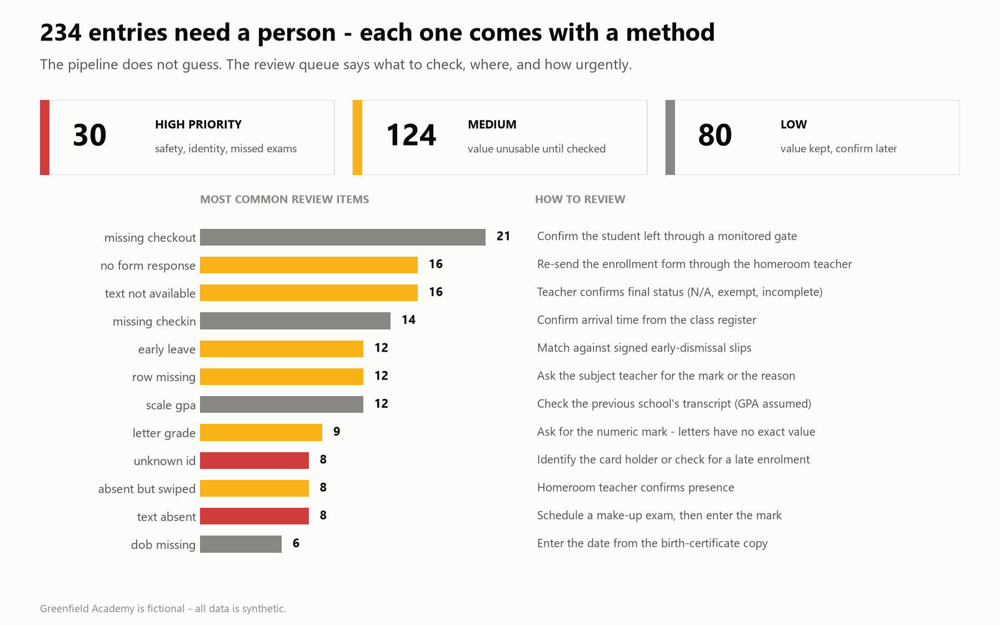
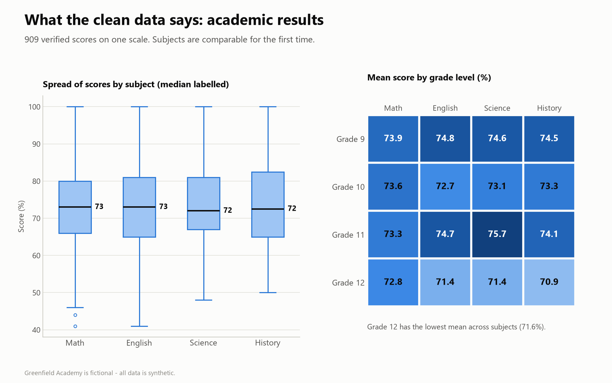
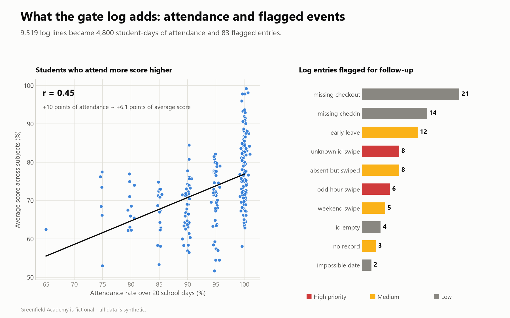
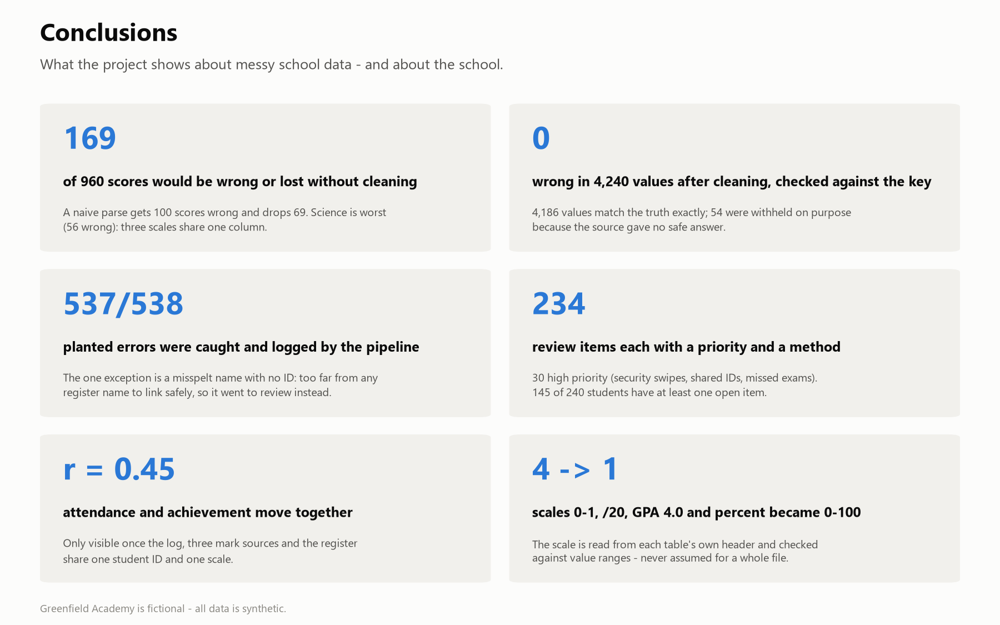

[العربية](README.ar.md)

# School Data: from six messy files to one trusted database

## Introduction

Schools rarely keep their data in one place. The registrar has an Excel register, parents fill in an
online form, each department reports marks its own way (a spreadsheet, a Word document, a PDF), and
the gate controller writes a log nobody reads. Each of those formats breaks in its own characteristic
way, and each uses its own scale, so the files cannot simply be stacked together.

This project reproduces that situation end to end for a fictional school, **Greenfield Academy**
(240 students, grades 9-12, Term 1 of 2026/27), and then solves it:

1. **Synthesize** - one "true" school is generated, then written out as six source files in five
   formats, with 538 deliberately planted errors typical of each format. The planted errors are
   recorded in a hidden answer key.
2. **Parse and clean** - a pipeline reads all six files, standardises notation, converts four
   different grading scales to one, cross-checks the sources against each other, and compiles a
   SQLite database and an Excel workbook. Every change is logged with the raw value beside the clean
   one. Anything that cannot be resolved safely is not guessed: it is withheld and put in a review
   queue with a priority and a method for carrying out the review.
3. **Showcase** - ten images explain what was done and what was found, including a score of the
   cleaning against the answer key.

All data is synthetic. No real school, student or family is represented.

## Headline results

| | |
|---|---|
| Source records read | 10,958 across 6 files (Excel x2, CSV, Word, PDF, log) |
| Cleaning actions logged | 573 (151 standardised, 174 corrected, 152 omitted, 49 missing, 47 flagged) |
| Entries queued for human review | 234 (30 high, 124 medium, 80 low priority) |
| Subject scores on one 0-100 scale | 909 of 960 (the other 51 are absent, withheld or never recorded) |
| Values checked against the answer key | 4,240 - **4,186 correct, 54 withheld, 0 wrong** |
| Same scores with a naive parse | 100 wrong and 69 lost out of 960 |
| Planted errors picked up | 537 of 538 (the last one was sent to review rather than guessed) |

## The showcase

| | |
|---|---|
|  **1. Project overview** - the three phases and the headline numbers. |  **2. The six sources** - what each file is and how it was broken. |
|  **3. Anomaly map** - which kind of problem turned up in which format. |  **4. Actions taken** - standardised, corrected, omitted, missing, flagged. |
|  **5. Scale harmonisation** - 0-1, /20, GPA and percent become one scale. |  **6. Naive vs cleaned** - both scored against the answer key. |
|  **7. Review queue** - what needs a person, how urgent, and how to check it. |  **8. Academic results** - what the clean data says about the subjects and grades. |
|  **9. Attendance and log flags** - what the gate log adds. |  **10. Conclusions** |

## What is in this folder

```
raw_data/        Phase 1 output - the six messy source files
  01_student_roster.xlsx              one sheet per grade; title rows, mixed date notations, shared IDs
  02_enrollment_form_responses.csv    online-form export; free-text answers on several scales
  03_gradebook_term1.xlsx             Math and English; coursework/40 + exam/60 = total/100
  04_science_department_results.docx  Word tables; 0-1 scale, Grade 11 out of 20
  05_history_gpa_report.pdf           7-page PDF table; GPA on a 4.0 scale
  06_gate_attendance.log              9,519 gate-controller lines over 20 school days
ground_truth/    the true values and the list of planted errors (never read by the cleaning step)
clean_data/      Phase 2 output
  school.db                 SQLite: students, guardians, grades, attendance_daily, attendance_summary,
                            log_flags, cleaning_log, review_queue, format_harmonisation, v_student_overview
  school_clean.xlsx         the same data in 11 filtered sheets, incl. Corrections / Omissions / Needs Review
  staging_grades.csv        raw value beside clean value for every score
reports/
  cleaning_report.md        corrections, omissions and review items, with the review method for each kind
  evaluation.json           the score against the answer key
showcase/        Phase 3 output - the ten images
scripts/         01_generate_sources.py -> 02_clean_and_compile.py -> 03_evaluate.py -> 04_showcase.py
```

## How the cleaning decides

- **Standardise** when only the notation differs: `stu_0042`, `STU-O042` and `42` are all `STU-0042`;
  `0,85` is `0.85`; `" SMITH "` is `Smith`.
- **Convert** when the scale is known. The scale is read from the table's own header (the Word file
  marks Grade 11 "/20") and checked against the value range, never assumed for a whole file. GPA is
  converted with the policy printed on the History report: *Percent = 50 + 12.5 x GPA*.
- **Cross-check** one source against another: a missing birth date is filled from the enrollment form;
  a total that disagrees with coursework + exam is replaced by the sum; two students sharing an ID are
  separated using the name-ID pair on the form. All of these are also sent for confirmation.
- **Withhold** when no rule gives a safe answer: `8.5` in a 0-1 column, GPA `4.8`, `B+` in a numeric
  cell, two different marks for one student. The cell is left empty and the entry goes to the review
  queue with a suggested value where one exists.

## Reproduce it

Python 3 with pandas, numpy, openpyxl, matplotlib, python-docx, reportlab and pdfplumber.

```
python scripts/01_generate_sources.py
python scripts/02_clean_and_compile.py
python scripts/03_evaluate.py
python scripts/04_showcase.py
```

The generator is seeded, so every run produces the same files and the same numbers.

## Limits worth knowing

- The errors were planted by the same author who wrote the cleaner, so "0 wrong" is a best case. Real
  files will contain error types nobody anticipated; the review queue is the safety net for those.
- The attendance-achievement relationship (r = 0.45) is built into the generator. The point of image 9
  is that the relationship only becomes measurable after the sources are linked, not that it was
  discovered.
- The PDF is text-based. A scanned PDF would need OCR first and would add a new class of errors.
